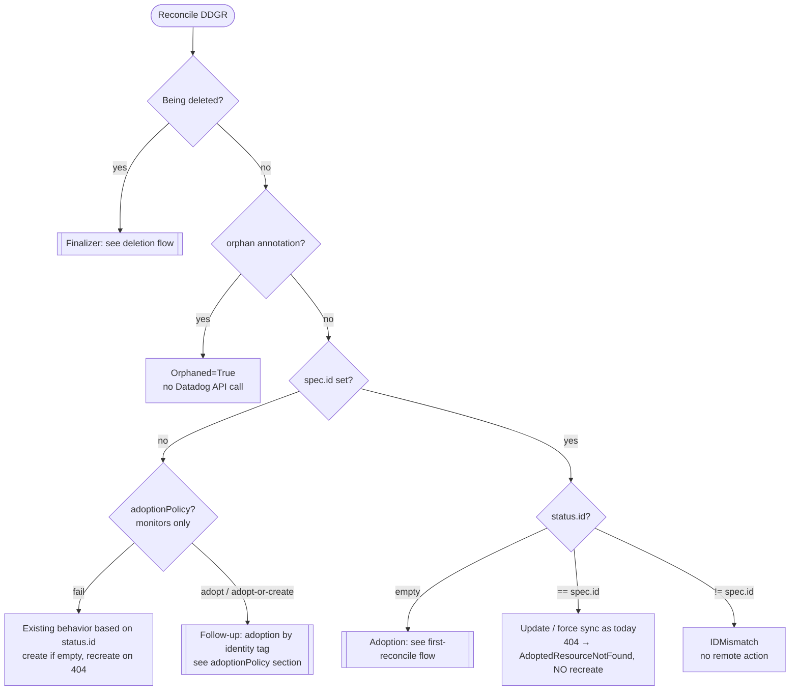
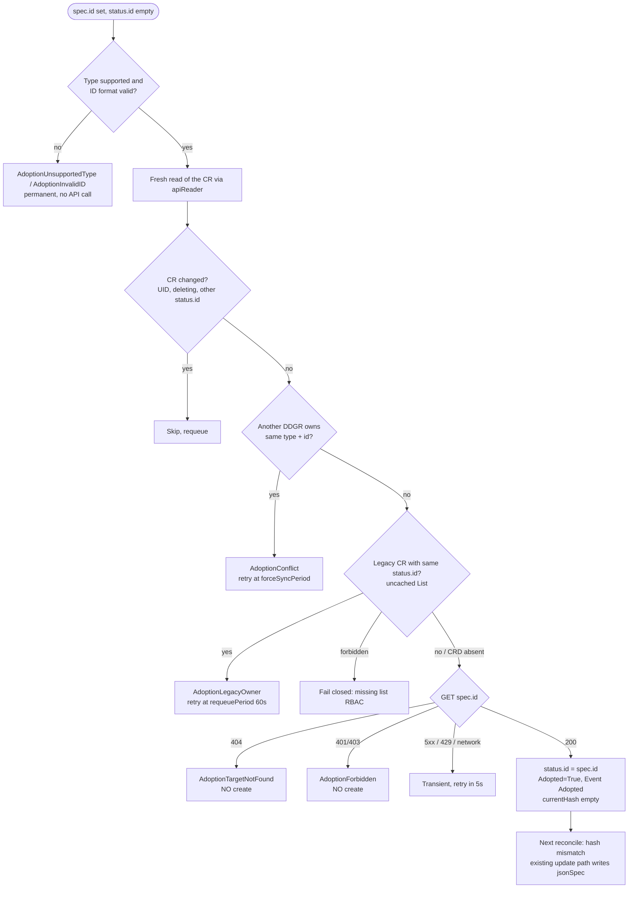
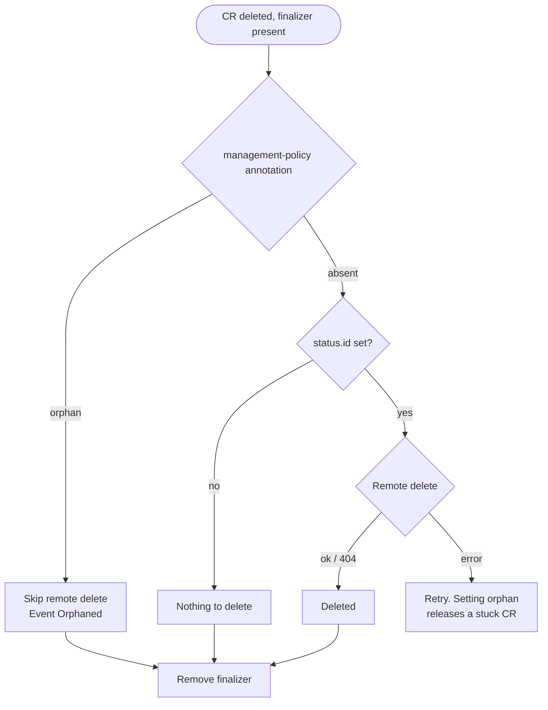
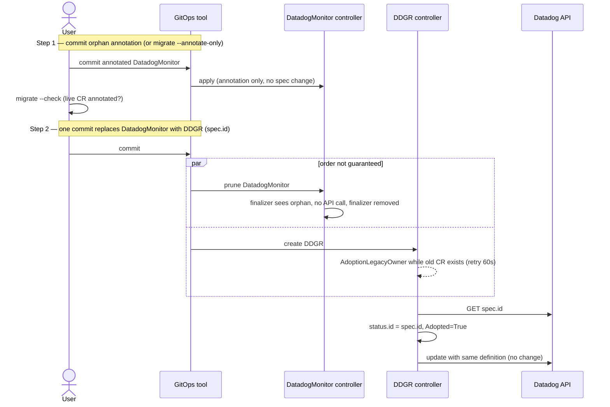
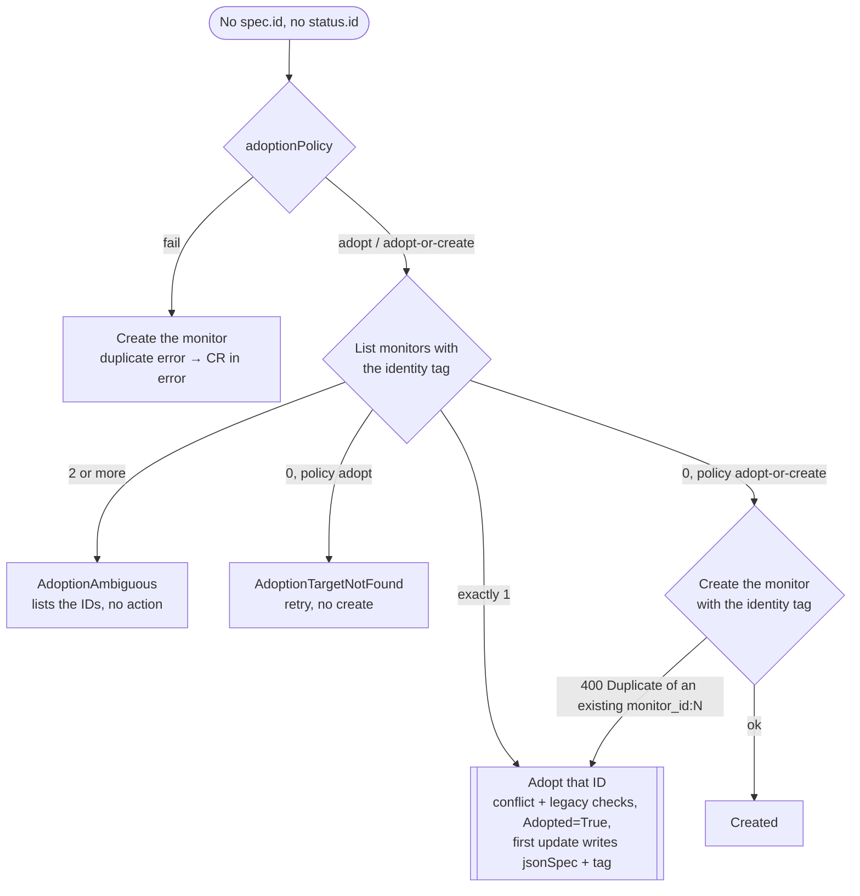

# Engineering brief: adopting existing Datadog resources with DatadogGenericResource

- **Ticket:** [CONTP-2280](https://datadoghq.atlassian.net/browse/CONTP-2280), part of [CONTP-2191](https://datadoghq.atlassian.net/browse/CONTP-2191)
- **Customer asks:** [FRCONS-1232](https://datadoghq.atlassian.net/browse/FRCONS-1232), [FRCONS-1251](https://datadoghq.atlassian.net/browse/FRCONS-1251), plus an active/passive DR question (see [Side benefit: active/passive clusters](#side-benefit-activepassive-clusters))
- **Status:** Draft for review by Operator maintainers. POCs are not covered here.

## Summary

Today a `DatadogGenericResource` (DDGR) always creates a new Datadog object and stores the new ID in `.status.id`. Customers migrating from `DatadogMonitor`, `DatadogDashboard` or `DatadogSLO`, or bringing resources created in the UI, API or Terraform, lose the ID. With it they lose history and every reference to the ID: composite monitors, SLOs, dashboards, links and automation.

This brief proposes:

1. **A new optional `spec.id` field on DDGR.** When it's set, the controller takes over the existing Datadog object with that ID instead of creating one. It **never creates a replacement** while `spec.id` is set. All validation happens in the controller, because CEL isn't available on every Kubernetes version we support.
2. **A `datadoghq.com/management-policy: orphan` annotation** for DDGR, `DatadogMonitor`, `DatadogDashboard` and `DatadogSLO`. The Operator stops managing an annotated CR: it no longer reconciles it, and deleting it leaves the Datadog object in place. This is the safe handoff that migration needs, and it also pauses a CR without disabling a whole controller.
3. **A blocking check against legacy CRs.** A DDGR can't adopt an ID that a `DatadogMonitor`, `DatadogDashboard` or `DatadogSLO` still manages. Two controllers never manage the same object.
4. **A `kubectl datadog monitor migrate` command** that converts a `DatadogMonitor` into an adopting DDGR in the safe order. It's the priority tool. A manual workflow is documented for the other legacy CRDs and for resources created outside Kubernetes.
5. **Follow-up: an opt-in `spec.adoptionPolicy` for monitors** (`fail` by default, `adopt`, `adopt-or-create`), similar to other controllers' adoption policies. It finds the monitor without an ID, through an identity tag the Operator adds, with the API's duplicate error as a best-effort fallback. It's for manifests that can't contain IDs, and ships after the first phase.

## Current behavior (baseline)

The behavior below comes from `internal/controller/datadoggenericresource/controller.go` and `internal/controller/finalizer/finalizer.go`.

| Situation | Today |
| --- | --- |
| `status.id` empty | Create a new object and store its ID in `status.id`. |
| Spec hash changed | Update the object identified by `status.id`. |
| Force sync (every 60 min by default) | GET the object. Monitors skip the update when the remote definition hash is unchanged. Other types always update. |
| 404 during force sync or update | **Recreate** the object, which gives it a new ID. |
| CR deleted, finalizer present | Delete the remote object (a 404 counts as success). The delete is skipped when `status.id` is empty. |
| CR without finalizer | The controller re-adds the finalizer on every reconcile unless the CR is being deleted. |
| Pre-setting `status.id` by hand | Not supported: `status` is a subresource, `kubectl apply` ignores it, backups usually don't restore it, and nothing validates it. |

Legacy CRDs behave the same way. One difference: `DatadogMonitor` only deletes monitors it created itself (the `status.primary` field). Both `DatadogMonitor` and `DatadogSLO` also inject a `generated:kubernetes` tag into the CR spec.

## Where the ID goes

### Options

| Option | Pros | Cons |
| --- | --- | --- |
| **A. `spec.id` (dedicated field)** | Typed and part of the schema. Visible in `kubectl get`. GitOps-friendly. Same pattern as Config Connector's `spec.resourceID`. | Requires a CRD change. On downgrade, an older CRD prunes the field (see [Compatibility](#compatibility)). Immutability is enforced by the controller, not at admission (no CEL). |
| B. Annotation (for example `datadoghq.com/id`) | No schema change. Same pattern as Crossplane's `external-name`. | Untyped. Easy to lose or copy by mistake. Mixes identity into metadata. Without CEL, neither A nor B can be validated at admission, so this isn't a difference. |
| C. `id` inside `jsonSpec` | No new field. | `jsonSpec` is the API create/update payload. `id` is response-only for most types, and the handlers unmarshal straight into create bodies. Contradicts the current migration guide ("do not put an existing Datadog ID in `spec.jsonSpec`"). Can't be validated without parsing per type. |

### Recommendation: `spec.id`

```go
type DatadogGenericResourceSpec struct {
    Type     SupportedResourcesType `json:"type"`
    JsonSpec string                 `json:"jsonSpec"`
    // ID of an existing Datadog resource to adopt instead of creating a new one.
    // When set, the Operator never creates a replacement resource.
    // +optional
    // +kubebuilder:validation:MinLength=1
    // +kubebuilder:validation:MaxLength=128
    ID string `json:"id,omitempty"`
}
```

**No CEL.** We still support Kubernetes versions where CRD validation rules (`x-kubernetes-validations`) aren't available. The only admission-time validation is plain OpenAPI (`MinLength`, `MaxLength`), which works on every supported version. Everything else is enforced by the controller and reported through conditions:

| Rule | Where it's enforced |
| --- | --- |
| ID format for `spec.type` | Controller, permanent error `AdoptionInvalidID` |
| `spec.id` not allowed for `software_catalog_entity` | Controller, permanent error `AdoptionUnsupportedType` |
| `spec.id` can't change once the object is adopted | Controller: `spec.id != status.id` with `status.id` set gives `IDMismatch` and no remote action |
| `spec.id` removed | Can't be blocked. Allowed, with defined behavior (see [Later reconciles](#later-reconciles)) |

A validating webhook could reject these at admission, but the Operator doesn't run admission webhooks today. Adding one for this alone isn't worth the deployment cost (certificates, availability).

How `spec.id` relates to `status.id`:

- `spec.id` is the **declared** identity. The user asks the controller to manage this object.
- `status.id` is the **observed** identity. It's the object the controller is managing right now.
- After a successful adoption, `status.id == spec.id`. Adding `spec.id` to a CR that already manages an object is accepted only when it equals `status.id`. That lets users write the ID back into their manifests (GitOps) after the first creation. Comparing `spec.id` with `status.id` is also how the controller enforces immutability without CEL.
- **`spec.id` is left out of the spec hash.** The hash (`status.currentHash`) decides whether `jsonSpec` must be written to Datadog, and `spec.id` doesn't change the payload. Leaving it out avoids a pointless update when users write the ID back into their manifests, and it costs nothing:
  - Existing CRs keep the same hash. `id` is `omitempty`, so an unset field serializes exactly as it does today, and upgrading doesn't trigger a wave of updates.
  - Changes to `spec.id` are still noticed. They bump `metadata.generation`, which triggers a reconcile, and the `spec.id` vs `status.id` check runs before the hash comparison.
  - The only cost is hashing a copy of the spec with `id` cleared, instead of hashing the spec directly.

Per-type ID formats (`status.id` is always a string):

| Type | ID format |
| --- | --- |
| `monitor`, `notebook` | integer |
| `dashboard` | `abc-def-ghi` |
| `slo`, `slo_correction` | string |
| `synthetics_*` | public ID `abc-def-ghi` |
| `downtime`, `monitor_notification_rule` | UUID |

The controller validates the format per type. A format error is a permanent error, so the controller doesn't retry until the spec changes.

### Example

```yaml
apiVersion: datadoghq.com/v1alpha1
kind: DatadogGenericResource
metadata:
  name: checkout-latency
spec:
  type: monitor
  id: "123456789"
  jsonSpec: |-
    {
      "name": "Checkout latency",
      "type": "query alert",
      "query": "avg(last_5m):avg:trace.http.request.duration{service:checkout} > 0.5",
      "message": "Checkout latency is high @slack-checkout",
      "tags": ["team:checkout", "generated:kubernetes"],
      "options": {"thresholds": {"critical": 0.5}}
    }
```

## Lifecycle when `spec.id` is set

The principle: **`jsonSpec` is the source of truth, and the ID is never silently replaced.** Adoption is explicit (the user wrote the ID), and its consequences are explicit too (the first reconcile writes `jsonSpec` and records an event).

How a reconcile is routed:



### First reconcile (adoption)



```
spec.id set, status.id empty:
  1. Validate spec.type and the ID format.          → permanent error AdoptionUnsupportedType / AdoptionInvalidID
  2. Fresh read of the CR (apiReader), same stale-cache guard as create().
  3. Check that no other DDGR in the cluster has the same type and id
     (field index on type and id).                  → error AdoptionConflict, retry at forceSyncPeriod
  4. Check that no legacy CR manages the same ID
     (see "Competing owners").                      → error AdoptionLegacyOwner, retry at requeuePeriod (60s)
  5. GET the resource by spec.id.
       404          → error AdoptionTargetNotFound, NO create, retry at forceSyncPeriod
       401/403      → error AdoptionForbidden, NO create, retry at forceSyncPeriod
       5xx/429/net  → transient, retry in 5s
  6. Persist status.id = spec.id, condition Adopted=True, Event "Adopted".
     CurrentHash stays empty.
  7. Next reconcile: the hash mismatch takes the existing update path and
     writes jsonSpec to the object, with Event "Updated".
```

Writing `status.id` before the first update reuses the existing update, force-sync and remote-hash code unchanged. It also means a crash between steps 6 and 7 can't lose the ID.

`status.created` and `status.creator` stay empty for adopted resources. Filling them would mean changing `getResource` in every handler to return metadata, which isn't worth it for informational fields.

### Later reconciles

| Situation | Behavior when `spec.id` is set |
| --- | --- |
| Drift / force sync | Same as today, including the monitor remote-hash skip. |
| 404 on GET or update | **No recreate.** Error condition `AdoptedResourceNotFound`, `status.id` is kept, and the controller retries at `forceSyncPeriod`. The user decides: restore the object, or delete the CR and create it again without `spec.id`. |
| Update fails (400, 403) | Same as today: error condition, retry at `forceSyncPeriod`. The remote object stays as it was. |
| `spec.id` changed after adoption | Error condition `IDMismatch`. No remote action, and the controller keeps `status.id`. The user reverts the change, or deletes and recreates the CR. |
| `spec.id` removed | Accepted. The controller falls back to the existing behavior based on `status.id`: it keeps managing the same object, and a later 404 recreates it. Documented as "removing `spec.id` gives up the no-replacement guarantee". |
| `spec.id` added later, equal to `status.id` | No-op: no remote call, because `spec.id` isn't part of the hash. |
| `spec.id` added later, different from `status.id` | Same as a change: `IDMismatch`, no remote action. |
| `spec.type` doesn't match the object | The GET uses the endpoint for `spec.type`, so a wrong type normally returns 404 and is reported as `AdoptionTargetNotFound`. |

When `spec.id` is not set, behavior doesn't change, including recreating the object on 404.

### Competing owners

| Owner | Detected? |
| --- | --- |
| Another DDGR in the same cluster with the same type and id | Yes, through a field index on the DDGR cache. The CR that already has `status.id` set wins. Otherwise the oldest `creationTimestamp` wins (then the name), so the outcome is stable when two CRs reconcile concurrently. The other CR gets `AdoptionConflict`. |
| A legacy CR (`DatadogMonitor`, `DatadogDashboard`, `DatadogSLO`) in the same cluster | **Yes, blocking.** See below. |
| Another cluster, Terraform, or a script | **Not detected.** A remote ownership marker (for example a tag) isn't available on every type (notebooks have no tags, and dashboards restrict tags). It would also fight with `jsonSpec`. Documented as unsupported. |

#### Blocking check against legacy CRs

<details>
<summary>Show details</summary>

A DDGR of type `monitor`, `dashboard` or `slo` doesn't adopt an ID while a CR of the matching legacy kind has the same `status.id`. The condition is `AdoptionLegacyOwner`, and its message names the CR and points to `kubectl datadog monitor migrate` or the orphan annotation. Adoption goes ahead on its own once the legacy CR is gone.

The controller retries at `requeuePeriod` (60s by default), not at `forceSyncPeriod` (60 min). During a GitOps migration this state can be expected rather than an error: if the GitOps tool creates the DDGR before the old CR is gone, the DDGR waits. It then adopts on its first retry after the old CR's finalizer completes, so at most `requeuePeriod` later. A watch on legacy kinds would react faster, but it brings back the informer problem described below. Each retry is a `GET` of the one blocking CR, not a list (see the snapshot below). A legacy CR that is terminating still blocks until it's deleted, because its finalizer might still delete the object.

**Feasibility.** The DDGR controller doesn't watch legacy kinds, and their informers only exist when the matching controller is enabled (`pkg/config/config.go`, `CacheOptions`). Relying on the shared cache would therefore miss legacy CRs whenever their controller is disabled. Those CRs still matter: they come back to life when someone re-enables the controller. Instead:

- **List each legacy kind once at startup through `apiReader`** (uncached), and keep an index from `status.id` to the CR. It needs no new informer, no field index and no watch, and it's independent of whether the legacy controller or its watch-namespace settings are enabled. See the snapshot below for why it's built once.
- **Match on `status.id`.** `DatadogMonitor.status.id` is an int and is compared as a string. `DatadogDashboard` and `DatadogSLO` use string IDs.
- **CRD not installed** (`NoKindMatch`): there can't be a legacy owner, so the check passes.
- **RBAC missing** (`Forbidden`): **fail closed** with an error naming the missing `list` permission. What each install grants today:
  - The generated role in this repo (`config/rbac/role.yaml`) grants all three kinds.
  - The Helm chart (`helm-charts`, `charts/datadog-operator/templates/clusterrole.yaml`) grants `datadogmonitors` and `datadogslos` **unconditionally**.
  - The chart grants `datadogdashboards` **only when `datadogDashboard.enabled`** is set. With the dashboard controller disabled, every `dashboard` adoption would fail closed.
  - **Required chart change:** grant `get`/`list` on `datadogdashboards` whenever `datadogGenericResource.enabled` is set.
  - With `rbac.create=false`, users manage RBAC themselves and get the explicit error.
- **Adoption is the only point where this needs checking.** Legacy CRDs can't adopt, so a legacy CR can't acquire an adopted ID later, except by setting `status.id` by hand, which isn't supported.

**Snapshot at startup.** The check matches on `status.id`, and the API server can't filter on it:

- Field selectors on custom resources only support `metadata.name` and `metadata.namespace`. CRD `selectableFields` would allow more, but needs Kubernetes 1.31 or later, which excludes versions we support.
- A metadata-only list (`PartialObjectMetadataList`) doesn't return `status`.

A list therefore fetches and decodes every CR of the legacy kind, with its full spec and status. Listing on every adoption doesn't scale: a GitOps commit that replaces N `DatadogMonitor`s at once means N lists of N objects, so N² objects in total, repeated every `requeuePeriod` for blocked DDGRs. With thousands of CRs, that loads the API server and etcd, and raises the Operator's memory with each concurrent reconcile.

Instead, the Operator lists each legacy kind **once at startup**, page by page (`Limit`/`Continue`), and keeps only an index from `status.id` to the CR's namespace and name. The cost is one list per kind per Operator start: a one-off memory spike, and one-off API server load.

- **Index hit:** the controller confirms with a `GET` of that CR. If it's gone, or its `status.id` no longer matches, the entry is dropped and adoption proceeds. Without this, a DDGR would stay blocked until the next restart after the old CR is deleted.
- **Index miss:** no legacy owner, adoption proceeds.
- **List fails at startup** (`Forbidden`, API errors): adoptions of that type fail closed, and the list is retried.
- **Accepted risk:** a legacy CR created after startup, or one that only gets its `status.id` after startup, isn't in the index. To collide, a DDGR would have to adopt the new object that CR creates, which means copying an ID that didn't exist at startup. A restart refreshes the index.

One limitation: the list covers the Operator's own cluster only, and legacy CRs in another cluster aren't visible. That falls under the cross-cluster row above.

</details>

### Management policy (orphan)

New annotation: `datadoghq.com/management-policy: orphan`. `orphan` is the only value: without the annotation, the CR behaves as it does today.

The Operator stops managing an annotated CR entirely:

- **No reconciliation:** no create, update, force sync or state refresh, so no Datadog API call. The CR gets an `Orphaned=True` condition, and its other status fields keep their last values.
- **Deletion:** the finalizer is removed without deleting the Datadog object.
- **Removing the annotation** resumes normal reconciliation. The next sync applies `jsonSpec` again.

This also covers pausing a single CR, for example on a passive cluster, without disabling a whole controller.



- It's handled in two shared places: a check at the start of each controller's reconcile, and `finalizer.HandleFinalizer`, which skips `deleteFunc` on deletion, records an `Orphaned` event and removes the finalizer.
- One change covers DDGR and the three legacy CRDs.
- It's an annotation rather than a spec field so that it works on the legacy CRDs without schema changes. Annotations are also outside the spec hash, so setting one doesn't trigger an update.
- It fixes the race in today's workaround. Today, removing the finalizer and then deleting the CR can fail because the controller re-adds the finalizer in between. With the annotation, the user annotates and deletes while the controller is running, with no need to stop it.
- Annotations can still be edited on a CR that is already being deleted. A CR stuck because its remote delete keeps failing can be released by setting `orphan`.

Should adopted resources default to `orphan`, the way `DatadogMonitor` only deletes what it created? **No**, recommended: without the annotation, deleting an adopted DDGR deletes the object. After migration, DDGR should behave like any other DDGR. A different default for some resources makes `kubectl delete` behavior depend on history the user can't see. See [Open questions](#open-questions).

## Migrating from a legacy CRD (DatadogMonitor, DatadogDashboard, DatadogSLO)

The order is **orphan the old CR first, then adopt.** The [blocking legacy check](#blocking-check-against-legacy-crs) enforces it: a DDGR can't adopt while the old CR exists. The only gap is a short period where the object is unmanaged, which is harmless.

For `DatadogMonitor`, use [`kubectl datadog monitor migrate`](#tooling). The manual equivalent below is also the workflow for `DatadogDashboard` and `DatadogSLO` until the tool covers them.

```shell
# 0. Operator version with spec.id and management-policy support; DDGR enabled.
# 1. Build the DDGR jsonSpec from the live object (same jq filters as the migration guide).
#    Keep the generated:kubernetes tag if the old CRD injected it: DDGR updates replace tags.
# 2. Release the old CR without deleting the Datadog object.
kubectl annotate datadogmonitor/checkout-latency datadoghq.com/management-policy=orphan
kubectl delete datadogmonitor/checkout-latency
# 3. Check the object still exists in Datadog, then adopt it.
kubectl apply -f checkout-latency-ddgr.yaml        # with spec.id: "<old status.id>"
kubectl wait --for=condition=Adopted ddgr/checkout-latency
```

Recovering from a partial migration:

| Failed at | State | Recovery |
| --- | --- | --- |
| DDGR applied before the old CR was deleted | `AdoptionLegacyOwner`. Nothing happens to the object. | Annotate and delete the old CR. The DDGR adopts on its next retry. |
| Step 2 (annotation missing, object deleted) | Object lost. The DDGR shows `AdoptionTargetNotFound`. Nothing is recreated by surprise. | Same as today: create a new object (drop `spec.id`). The migrate tool exists to remove this mistake. |
| Step 3 (bad `jsonSpec`, 403) | `status.id` is set, the update failed, and the remote object is untouched. | Fix `jsonSpec`. The controller retries. |
| Rollback to the legacy CRD | Not possible with the same ID: legacy CRDs can't adopt. | Fix forward with DDGR. To revert anyway, annotate the DDGR `orphan` first, so removing it doesn't delete the object. |

### GitOps (Argo CD, Flux)

<details>
<summary>Show details</summary>

GitOps users don't delete the old CR themselves: the GitOps tool prunes it when its manifest leaves Git. A prune deletes the object **as it exists in the cluster**. So the orphan annotation must be on the live CR *before* the manifest is removed. Adding it to the manifest that you remove in the same commit doesn't work: that version is never applied.

**Step 1: put the orphan annotation on the live `DatadogMonitor`.** Pick one:

- **(a) Commit the annotation** to the `DatadogMonitor` manifest and wait for the sync. This is recommended: the safety-critical state lives in Git. `migrate -o yaml` prints the annotated manifest.
- **(b) Annotate in the cluster** with `kubectl datadog monitor migrate <name> --annotate-only`. Argo CD and Flux leave alone annotations that Git doesn't set, including with self-heal: client-side apply only manages fields from the manifest, and server-side apply leaves fields owned by another field manager. This saves a commit, but someone reading the repo can't see the protection.

`migrate --check` reports whether the live CR is annotated. Users run it before step 2.

**Step 2: one commit replaces the `DatadogMonitor` manifest with the DDGR manifest** from `migrate -o yaml`. When the tool syncs:

- The prune deletes the `DatadogMonitor`, and the orphan annotation keeps the monitor.
- The DDGR adopts the monitor and writes the same definition, so the monitor doesn't change.

The design doesn't depend on the order in which the GitOps tool creates the DDGR and prunes the old CR, and the brief makes no assumption about it:
- **Old CR gone first:** the DDGR adopts on its first reconcile.
- **DDGR created first,** or while the old CR is still terminating: the DDGR reports `AdoptionLegacyOwner` and adopts on its first retry after the old CR is gone, at most `requeuePeriod` (60s) later.



**The `DatadogMonitor` controller must keep running until the old CR is gone.** The orphan annotation is applied by that controller's finalizer. If the controller is disabled while the CR is deleted, the CR stays terminating, and the DDGR stays blocked (a terminating legacy CR still blocks). Users disable `-datadogMonitorEnabled` only after the migration.

**Without auto-prune** (Argo CD without `prune`, Flux with `prune: false`), the `DatadogMonitor` stays in the cluster after its manifest leaves Git. The DDGR stays blocked, and its condition message says to delete the old CR. Deleting it is safe because it's annotated.

**One manifest deployed to several clusters** (ApplicationSet, one Flux `Kustomization` per cluster): each cluster's `DatadogMonitor` created **its own** monitor, so the IDs differ between clusters.
- `migrate` always writes the full DDGR manifest, including `spec.id`, for the cluster it runs against. Users run it once per kube context.
- Users decide how to lay the result out in their repo, for example one manifest per cluster overlay, or the ID in per-cluster Helm values.
- A DDGR deployed without its `spec.id` creates a new monitor, which is today's behavior. The docs must call this out.

**Templated manifests** (Helm charts, Kustomize bases that generate `DatadogMonitor`s): the tool can't edit the user's templates.
- `migrate -o json` prints just the `jsonSpec` and the ID, ready to paste into a template or values file.
- The migration guide gets a short Helm example that renders `jsonSpec` from values.

**Drift goes away.** The `DatadogMonitor` controller writes `generated:kubernetes` into the CR spec, so GitOps tools often show these CRs as OutOfSync. The DDGR has no such problem: the tag is already in the committed `jsonSpec`, and the DDGR controller never writes to the spec.

</details>

### Old Operator versions

The annotation needs the new Operator version on the legacy controllers. On older versions: disable the legacy controller (`-datadogMonitorEnabled=false`, and so on), remove the finalizer, then delete the CR.

## Adopting resources created outside Kubernetes (UI, API, Terraform)

<details>
<summary>Show details</summary>

1. **Export the definition.** Use the existing `jq` recipes from the migration guide, which strip response-only fields, and add `spec.id`.
2. **Hand off from the previous manager.**
   - **Terraform:** run `terraform state rm`, or use a `removed` block with `lifecycle { destroy = false }`, *before* applying the DDGR. Otherwise both tools fight on every apply and force sync.
   - **UI:** nothing to remove. Optionally restrict edits (monitor/dashboard restriction policies) so that force sync doesn't keep reverting UI changes.
3. **Apply and verify** the `Adopted` and `Updated` conditions.

**Read-only / observe phase: deferred.** A mode that adopts without writing, and reports the diff between `jsonSpec` and the remote object, would make the first update less surprising. It needs a per-type normalization of API responses against create payloads, which we only have for monitors (the definition hash). The first update is already explicit and visible in Events. Users who want a dry run can compare the exported JSON with their `jsonSpec` before applying.

</details>

## Follow-up: adoption without an ID (`adoptionPolicy`, monitors only)

> **Status: follow-up phase.** It ships after adoption with `spec.id` and reuses the same adoption path. Nothing in the first phase depends on it.

`spec.id` needs the ID in the manifest, and manifests often can't contain one:

- They're written before the object exists.
- The same manifest is deployed to several clusters.
- A cluster is rebuilt from Git, which loses the CRs and the `status.id` they held.

Other controllers handle this with an adoption policy. [AWS Controllers for Kubernetes](https://aws-controllers-k8s.github.io/docs/guides/adoption/) (ACK) offers `adopt` and `adopt-or-create`. Crossplane identifies existing resources by an external name. This follow-up brings the same model to DDGR, starting with monitors, as raised in review.

### Proposal

A per-resource setting, shown here as an optional field `spec.adoptionPolicy` (a field or an annotation, see [Open questions](#open-questions)), plus an Operator-wide default. It only applies when `spec.id` isn't set. An explicit ID always wins and never falls back to a lookup.

| Policy | Behavior when the DDGR has no `status.id` |
| --- | --- |
| `fail` (default) | Today's behavior: create a new monitor. If the API rejects it as a duplicate, the CR stays in error. |
| `adopt` | Find the existing monitor by its identity tag and adopt it. If none is found, **don't create one**: set an error condition and retry. |
| `adopt-or-create` | Same as `adopt`, but create the monitor when none is found. |

- **Operator-wide default:** `--datadogGenericResourceAdoptionPolicy` / `DD_GENERIC_RESOURCE_ADOPTION_POLICY`, default `fail`. Users can then turn the policy on without editing every manifest.
- **Precedence:**
  1. The per-resource setting, **only when it's explicitly set**. An explicit `fail` therefore opts a resource out of an Operator-wide `adopt-or-create`.
  2. Otherwise, the Operator-wide default.
  3. Otherwise, `fail`.
- **Identity tag:** with `adopt` or `adopt-or-create`, the Operator adds a Datadog monitor tag that identifies the CR, for example `datadog_operator_adoption_key:<namespace>/<name>`. The `datadoghq.com/adoption-key` annotation overrides the value.
- **Same safety checks as `spec.id`:** a conflicting DDGR in the cluster, a legacy CR with that ID, the `Adopted` condition and event, then a first update that writes `jsonSpec`.

**Why monitors only:** a lookup without an ID needs a way to find exactly one object. Monitors can be listed by tag, and their API rejects exact duplicates. Dashboards, SLOs and the other types accept duplicates and have no equivalent lookup, so `adopt` and `adopt-or-create` on them give a permanent `AdoptionUnsupportedType` error. The controller checks this, since we can't use CEL.



<details>
<summary>Show details</summary>

#### Identity tag

- The tag value must be **the same wherever the manifest is applied**, so it never includes a cluster name or UID. `<namespace>/<name>` works when the namespaces are the same everywhere. Otherwise users set `datadoghq.com/adoption-key`.
- Datadog lowercases tags and limits them to 200 characters. The controller lowercases the key and rejects keys that are too long or use characters a tag can't hold, with a permanent `AdoptionInvalidKey` error.
- The tag is added to the payload of **every create and update**, so an edit in the UI that removes it is undone on the next sync. Users don't write it in `jsonSpec`.
- **It doesn't cause drift.** An injected tag could look like a difference on every force sync. It doesn't: `status.remoteDefinitionHash` is computed from the monitor Datadog returns after each write, not from `jsonSpec`, and that monitor already includes the tag. To confirm in the POC.
- The tag is only added with `adopt` and `adopt-or-create`. With `fail`, existing monitors don't change, so enabling the policy on some resources doesn't trigger a wave of updates for all of them.

#### Lookup

- `ListMonitors` with `monitor_tags=<identity tag>` returns the monitors that carry the tag. It filters on an exact tag, unlike `SearchMonitors`, which goes through the search index and its query syntax. Whether the list is consistent right after a create is unknown; we need to check with the monitors team.
- **Exactly one match:** adopt it.
- **Two or more:** don't guess. `AdoptionAmbiguous`, with the IDs in the message, and no remote action.
- **None:** `adopt` reports `AdoptionTargetNotFound` and retries at `forceSyncPeriod`. `adopt-or-create` creates the monitor.

#### Duplicate-error fallback (best effort)

When `adopt-or-create` creates the monitor and the API answers `400 Duplicate of an existing monitor_id:<id>`, the controller adopts `<id>`, after the same checks as any adoption. Adopting automatically on a duplicate error only happens under this opt-in policy, never by default.

It's a safety net, not a guarantee:

- **The error text isn't an API contract.** The controller extracts the ID from the message. If the message changes, the fallback stops working and the CR stays in error, which is today's behavior. It never adopts the wrong monitor because of a format change.
- **We don't know the duplicate rules.** Only an "identical" monitor triggers the error, and which fields count is undocumented.
- **It mostly covers races, not old monitors.** The create payload includes the identity tag. An existing monitor without the tag therefore probably differs in its tags and isn't a duplicate, so a second monitor gets created. The fallback catches two creates of the same manifest at the same time, or a list that hasn't caught up yet. Existing monitors without the tag must be adopted once by ID (see below).
- **Monitor-only.** The other types accept duplicates, so no equivalent exists.

#### Deleted monitor (404)

- With `adopt` or `adopt-or-create`, a 404 on a monitor tracked in `status.id` clears `status.id` and runs the lookup again, instead of recreating straight away. The monitor may have been recreated elsewhere under a new ID.
- With `fail`, the behavior stays as today (recreate). With `spec.id`, it's an error with no recreate, as described above.

#### Getting existing monitors tagged

Monitors created before the policy is enabled don't have the identity tag:

1. Adopt them once by ID, with `spec.id` and the policy set. The first update adds the identity tag. For `DatadogMonitor` users, `kubectl datadog monitor migrate --adoption-policy adopt-or-create` generates these manifests.
2. Once a monitor is tagged, `spec.id` can be removed from its manifest. From then on, applying the manifest anywhere finds the monitor by its tag.

#### What stays unsupported

- **Two controllers managing the same manifest at once.** The tag says which monitor belongs to a manifest, not whether another Operator still manages it. If two clusters run the controller on the same manifests, both write to the same monitor, as with `spec.id`.
- **Other resource types**, for the reasons above.

</details>

## Tooling

<details>
<summary>Show details</summary>

| Path | Plan |
| --- | --- |
| `DatadogMonitor` → DDGR | **`kubectl datadog monitor migrate`: priority**, shipped with the feature. |
| `DatadogDashboard` / `DatadogSLO` → DDGR | Manual workflow first. The same command pattern can be extended later. |
| External → DDGR | Manual workflow (API export + `jq` + `spec.id`). `import --type monitor --id 123` is deferred: it would need per-type field-stripping lists kept up to date in code. |

### `kubectl datadog monitor migrate`

It's a new subcommand of the existing plugin (`cmd/kubectl-datadog`).

```shell
kubectl datadog monitor migrate <name> [-n <namespace>] [--dry-run] [-o yaml|json] [--adoption-policy adopt-or-create]
kubectl datadog monitor migrate <name> --annotate-only   # GitOps option (b)
kubectl datadog monitor migrate <name> --check           # is the live CR annotated? is the DDGR adopted?
```

1. **Preflight.** Read the `DatadogMonitor` and refuse to continue unless:
   - `status.id` is set.
   - The CR is in sync: `status.currentHash` matches its spec, and there's no error condition. Otherwise the live monitor may not match the CR.
   - It isn't already terminating.
   - No DDGR in the cluster already uses that ID.
2. **Build `jsonSpec` from the CR, not from the API.** Reuse the controller's own conversion (`buildMonitor` in `internal/controller/datadogmonitor/monitor.go`, which needs to be exported). This gives three guarantees:
   - The DDGR sends the same payload the old controller sent, so the first DDGR update doesn't change the monitor's definition.
   - The `generated:kubernetes` tag the old controller injected is kept.
   - The tool needs no Datadog API or application keys.
3. **Build the DDGR:**
   - Same name and namespace (it's a different kind, so they don't clash).
   - User labels and annotations are copied over. GitOps tracking metadata (`argocd.argoproj.io/*`, `kustomize.toolkit.fluxcd.io/*`, `kubectl.kubernetes.io/last-applied-configuration`) is not.
   - `type: monitor`, `id: <status.id>`.
   - Follow-up: with `--adoption-policy`, the policy too, so the first update also adds the identity tag (see [Getting existing monitors tagged](#getting-existing-monitors-tagged)).
4. **Apply** (skipped with `--dry-run` and with `-o`):
   1. Annotate the old CR with `management-policy=orphan`.
   2. Delete it and wait until it's gone.
   3. Create the DDGR and wait for `Adopted=True` and `Updated=True`.
5. **Resumable.** Rerunning the command after a failure detects where it stopped and continues from there. The possible states are: old CR annotated, old CR gone with no DDGR, and DDGR created but not yet adopted.
6. **Output modes for GitOps.** With any of these, the tool changes nothing in the cluster:

| Output | Contents |
| --- | --- |
| `-o yaml` | The annotated `DatadogMonitor` (step 1a) and the DDGR (step 2) |
| `-o json` | Only `jsonSpec` and the ID, for Helm or other templates |

The command runs with the user's kubeconfig and needs `get/update/delete` on `datadogmonitors` and `get/create/update` on `datadoggenericresources`.

`--all` (migrating every `DatadogMonitor` in a namespace) is a straightforward follow-up once the single-resource flow is proven.

</details>

## Supported types and limitations

Adoption doesn't depend on the type: it's a GET by ID followed by the existing update path. Every type addressed by ID can be enabled at once. Tests and docs focus on the migration targets.

| Type | Initial support | Notes |
| --- | --- | --- |
| `monitor` | Yes, priority | Integer ID. Monitor `type` changes are limited by the API. `restriction_policy` disables the hash skip. The only type that supports `adoptionPolicy`. |
| `dashboard` | Yes, priority | The update replaces the whole dashboard (PUT). Check layout constraints in the POC. |
| `slo` | Yes, priority | Keeps `monitor_ids` references, which is a main reason for adoption. Check type immutability in the POC. |
| `notebook`, `synthetics_api_test`, `synthetics_browser_test`, `downtime`, `monitor_notification_rule` | Yes | Generic path. Light test coverage. |
| `slo_correction` | Yes | `slo_id` is create-only. The handler already rejects changing it, and the same check applies after adoption. |
| `software_catalog_entity` | **No** (the controller rejects `spec.id` with `AdoptionUnsupportedType`) | Upsert is keyed by `kind/namespace/name`, so creating the CR already "adopts" an existing entity. `spec.id` would be redundant or conflicting. |

## Non-goals

- Implicit adoption. Adopting by identity tag or on a duplicate error only happens with an explicit `adopt` or `adopt-or-create` policy, and `fail` stays the default.
- Adoption without an ID for types other than monitors. They accept duplicates and have no reliable lookup.
- Detecting owners across clusters or tools, and multiple active owners.
- Adoption in legacy CRDs.
- Bulk discovery or import of every resource in an org.
- Supported active/passive disaster recovery (see below).

## Side benefit: active/passive clusters

<details>
<summary>Show details</summary>

Some users run several clusters per environment in an active/passive setup:

- Every cluster deploys the same manifests from Git, with no IDs.
- Only the active cluster runs the controller. Passive clusters have it turned off.
- When a passive cluster becomes active, it can't take over the monitors the old active cluster created: creates fail as duplicates, and every failover means fixing ownership by hand, for thousands of monitors.

Supporting DR isn't a goal. Even so, `spec.id`, the orphan policy and, in the follow-up, `adoptionPolicy` give this setup a reasonable pattern without any DR-specific code.

**With the first phase (`spec.id`):** write each monitor's ID into the manifests. In this setup only the active cluster creates monitors, so the ID is the same on every cluster. Failover then adopts by ID.

**With the follow-up (`adoptionPolicy`)**, no IDs to copy:

1. Deploy **identical manifests to every cluster**, with `adoptionPolicy: adopt-or-create` (or the operator-wide default) and no IDs. Monitors that existed before get their identity tag once, through adoption by ID (see [Getting existing monitors tagged](#getting-existing-monitors-tagged)).
2. Run the DDGR controller only in the active cluster: in passive clusters, set `-datadogGenericResourceEnabled=false`, scale the Operator to 0, or annotate the CRs `orphan` (for example through a per-cluster overlay).
3. **Failover, or a cluster rebuilt from Git:** enable the controller in the new active cluster. It finds each monitor by its identity tag and adopts it, so there's no duplicate, no new ID and no lost history. Nobody has to copy IDs between clusters.
4. **Retire the old cluster:** stop its controller, or annotate its CRs with `orphan` and delete them.

For types other than monitors, the first-phase pattern with `spec.id` still applies.

Still unsupported: both controllers active at the same time. They overwrite each other on force sync, and this isn't detected. With `spec.id`, an out-of-band delete produces an error instead of a recreate. With `adoptionPolicy`, it triggers a new lookup first, so a monitor recreated by another cluster is found again.

</details>

## Compatibility

- `spec.id` is optional. Without it, nothing changes for existing CRs.
- `adoptionPolicy` defaults to `fail`, which is today's behavior. The identity tag is only added with `adopt` or `adopt-or-create`, so existing monitors aren't touched.
- No CEL or webhook, so the CRD keeps working on every Kubernetes version we support.
- The annotation is opt-in. Without it, reconciliation and deletion don't change.
- **Downgrade risk:** an older CRD prunes `spec.id`. An *already adopted* CR keeps `status.id` and keeps working. A CR that was *not yet adopted* (empty `status.id`) would be **created as a new object** by an older Operator. Document this: finish adoptions before downgrading.
- The migration guide needs updating: remove "DDGR does not adopt an existing object" and describe the new workflow (CONTP-2283).

## Test matrix

<details>
<summary>Show details</summary>

| # | Case | Expected |
| --- | --- | --- |
| 1 | `spec.id` set, object exists (monitor, dashboard, slo) | `Adopted=True`, same ID, `jsonSpec` applied once, no create call |
| 2 | `spec.id` set, object missing | `AdoptionTargetNotFound`, no create, retry at force sync |
| 3 | `spec.id` set, 403 | `AdoptionForbidden`, no create, remote object untouched |
| 4 | Invalid ID format (for example `abc` for a monitor) | Permanent error, no API call |
| 5 | Wrong `spec.type` for the ID | `AdoptionTargetNotFound` |
| 6 | Two DDGRs with the same type and id | The one with `status.id` set, or else the older one, wins. The other gets `AdoptionConflict`. |
| 7a | `spec.id` changed after adoption | `IDMismatch`, no remote action, `status.id` kept |
| 7b | `spec.id` removed after adoption | Accepted. Existing `status.id`-based behavior resumes (a 404 recreates). |
| 8 | `spec.id` added later, equal to `status.id` | Accepted, no remote call |
| 8b | Upgrade with existing DDGRs that have no `spec.id` | Same `currentHash`, no updates triggered |
| 9 | `spec.id` added later, different from `status.id` | `IDMismatch`, no remote action |
| 10 | Adopted object deleted out of band | Error, **no recreate** |
| 11 | Stale cache during adoption (`status.id` already persisted) | No second adoption or update from the stale object |
| 12 | Crash between persisting `status.id` and the first update | Next reconcile updates. No duplicate. |
| 13 | `management-policy: orphan` on DDGR, DatadogMonitor, DatadogDashboard, DatadogSLO | CR deleted, remote object kept, `Orphaned` event |
| 14 | Annotation added to a CR already terminating with a failing delete | Finalizer released |
| 15 | Full legacy migration (annotate → delete → adopt) for monitor, dashboard, slo | Same ID. References (composite monitor, SLO `monitor_ids`) still resolve. |
| 16 | `software_catalog_entity` with `spec.id` | `AdoptionUnsupportedType`, no API call |
| 17 | No `spec.id` | Unchanged behavior, including recreate on 404 |
| 18 | `slo_correction` adopted, `slo_id` changed | Existing rejection still applies |
| 19 | DDGR adopts an ID held by a `DatadogMonitor` (also with the `DatadogMonitor` controller disabled) | `AdoptionLegacyOwner`, no remote action. Adopts after the legacy CR is deleted with `orphan`. |
| 20 | Legacy CR is terminating with the same ID | Still blocked until it's gone |
| 21 | Legacy CRD not installed | Check passes |
| 22 | Operator can't `list` the legacy kind | Fails closed with an explicit RBAC error |
| 23 | `monitor migrate` happy path | Same monitor ID, no definition change on the first DDGR update, `generated:kubernetes` tag kept |
| 24 | `monitor migrate` preflight: CR out of sync, in error, or without `status.id` | Refuses, changes nothing |
| 25 | `monitor migrate` interrupted after each step, then rerun | Picks up where it stopped. Monitor never deleted. |
| 26 | `monitor migrate -o yaml` / `--dry-run` | Prints manifests and changes nothing in the cluster |
| 27a | GitOps: DDGR created before the `DatadogMonitor` is pruned | `AdoptionLegacyOwner`, then adopts at most `requeuePeriod` after the old CR is gone |
| 27b | GitOps: `DatadogMonitor` pruned before the DDGR is created | Adopts on the first reconcile |
| 27c | `DatadogMonitor` controller disabled while the annotated CR is deleted | CR stays terminating. DDGR blocked with an explicit message. Monitor kept. |
| 27d | `dashboard` adoption with the Helm chart and `datadogDashboard.enabled=false` | Adoption proceeds once the chart change grants `list` on `datadogdashboards` |
| 28 | GitOps: annotation and manifest removal in the same commit | Monitor deleted (documented failure mode). `migrate --check` would have reported "not annotated". |
| 29 | `--annotate-only`, then Argo CD self-heal / Flux reconcile (client-side and server-side apply) | Annotation survives |
| 30 | No auto-prune | DDGR blocked until the old CR is deleted by hand, with an explicit message |
| 31 | Same `DatadogMonitor` manifest in 2 clusters, `migrate -o yaml` run per cluster | Each output has that cluster's `spec.id`. Each DDGR adopts its own cluster's monitor. |
| 32 | Orphaned DDGR: spec change, force sync and state refresh | No Datadog API call, `Orphaned=True` |
| 33 | Orphan annotation removed | Normal reconciliation resumes, the next sync applies `jsonSpec` |
| 34 | `adopt`, exactly one monitor with the identity tag | Adopted, `reason=MatchedIdentityTag`, first update keeps the tag |
| 35 | `adopt`, no monitor with the tag | `AdoptionTargetNotFound`, no create |
| 36 | `adopt-or-create`, no monitor with the tag | Monitor created with the tag |
| 37 | `adopt` or `adopt-or-create`, two monitors with the tag | `AdoptionAmbiguous` listing both IDs, no action |
| 38 | `adopt-or-create`, create returns `Duplicate of an existing monitor_id:N` | Adopts N after the conflict and legacy checks, `reason=DuplicateError` |
| 39 | Duplicate error with an unexpected message format | CR stays in error (today's behavior), nothing adopted |
| 40 | `adopt` or `adopt-or-create` on a non-monitor type | `AdoptionUnsupportedType`, no API call |
| 41 | Identity tag removed in the UI | Added back on the next sync |
| 42 | Force sync after adoption with the tag | No update while the monitor is unchanged (tag doesn't count as drift) |
| 43 | 404 on a tracked monitor with `adopt-or-create` | `status.id` cleared, lookup again, adopts the monitor recreated elsewhere or creates one |
| 44 | Cluster rebuilt from Git with `adopt-or-create` (CRs recreated without `status.id`) | Every monitor adopted by tag. No duplicates. |
| 45 | `spec.id` and `adoptionPolicy` both set | `spec.id` wins. No tag lookup, no fallback. |
| 46 | Operator-wide default `adopt-or-create`, CR without a per-resource setting | Uses the Operator-wide default |
| 47 | Operator-wide default `adopt-or-create`, CR explicitly set to `fail` | Uses `fail`: the explicit per-resource setting wins |
| 48 | Operator startup with 1,000, 5,000 and 10,000 `DatadogMonitor` CRs | Measure the startup list: latency and response size of `LIST datadogmonitors` (`apiserver_request_duration_seconds`, `apiserver_response_sizes`), API server CPU and memory, and the Operator's peak memory. |
| 49 | Same sizes, as many adopting DDGRs applied at once | Every DDGR adopts, with one `GET` per index hit and no further list. Measure the total time until all are adopted. |
| 50 | Legacy CR in the startup index deleted, DDGR waiting on it | The `GET` returns 404, the entry is dropped, the DDGR adopts on its next retry |

</details>

## Open questions

1. ~~**Field name:** `spec.id` (mirrors `status.id`) or something more explicit (`spec.datadogID`, `spec.adoptID`)?~~
   1. Start with `spec.id`. `spec.datadogID` was also suggested, and the name can still change until the CRD ships.
2. ~~**Deleting an adopted DDGR:** when a DDGR that adopted an existing object (with `spec.id`) is deleted later, should the Datadog object be deleted like for any other DDGR (recommended, uniform), or kept by default because this DDGR didn't create it (safer, like `DatadogMonitor`'s `primary`)?~~
   1. Deleted like for any other DDGR, with no special handling.

---

3. ~~**Follow-up, naming:** `adoptionPolicy` or `duplicatePolicy`? `adoptionPolicy` describes what it controls, which is more than the duplicate error.~~
   1. `adoptionPolicy`.
4. **Follow-up, per-resource setting as a field or an annotation?**
   - **CRD field (`spec.adoptionPolicy`):** typed, visible in the schema and in `kubectl explain`, and the allowed values can be checked at admission with a plain OpenAPI enum (no CEL needed). Needs a CRD change.
   - **Annotation (for example `datadoghq.com/adoption-policy`):** no CRD change, and consistent with the other adoption controls, which are already annotations (`datadoghq.com/management-policy`, `datadoghq.com/adoption-key`). Values are only checked by the controller: a typo is reported as a permanent error on the CR instead of being rejected at admission.
5. **Follow-up, identity tag:** is `datadog_operator_adoption_key:<namespace>/<name>` the right name and default value? Is `<namespace>/<name>` stable enough across clusters, or should the annotation be required?
6. **Follow-up, for the monitors team:** which fields make two monitors duplicates? Is the duplicate message format stable? Is `ListMonitors` with `monitor_tags` consistent right after a create?
